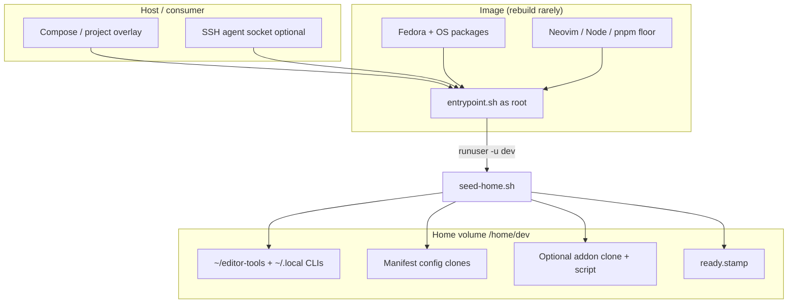

# Architecture

nvim-sandbox separates a **stable image** from a **mutable home volume**. Seed
runs once per boot (as uid 1000) before the container’s main command.

## Layers

## Boot sequence

1. Container starts as **root** (do not set Compose `user:`).
2. `entrypoint.sh` optionally proxies the host SSH agent via `socat`.
3. `runuser -u dev` runs `seed-home.sh` with the remaining CMD args.
4. Seed installs/refreshes mutable tools, clones manifest configs, optionally
   runs the addon, then writes `ready.stamp` and `exec`s the CMD.
5. Consumers wait for the stamp, then `docker compose exec -u dev …`.

## Trust boundaries

| Boundary | Who runs | Trust |
|----------|----------|--------|
| Image build / entrypoint | root | You / this repo |
| Seed tools + manifest clones | uid 1000 (`dev`) | Manifest remotes you enable |
| Addon script | uid 1000 only | `EDITOR_ADDON_REPO` (opt-in RCE-as-dev) |

See [SECURITY.md](../SECURITY.md) for reporting and threat-model notes.
